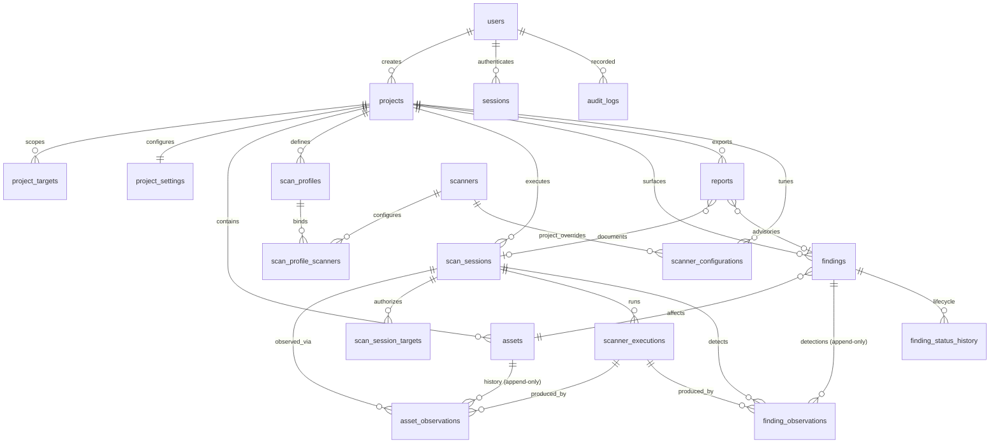

# WADJET Database Design

PostgreSQL 13+ · UUID primary keys (`gen_random_uuid()`) · JSONB for flexible
scanner payloads · **no stored procedures, no triggers** — all business logic
lives in Go. Schema source of truth: `migrations/0001_init.sql`.

## Conventions

| Convention | Rule |
|---|---|
| Keys | `uuid PRIMARY KEY DEFAULT gen_random_uuid()` |
| Time | `timestamptz`, `created_at` server-default; `updated_at` maintained by Go |
| Arrays | `text[]` for tags/CVEs/targets; JSONB for structured config/evidence |
| History | `*_observations` tables are append-only, never updated or deleted |
| Isolation | every query path filters by `project_id` |
| Reserved words | `references` always quoted as `"references"` |

## ER diagram

## Table guide

### Identity & access
- **users** — email unique; `password_hash` bcrypt; role `admin|user`.
- **sessions** — opaque tokens stored as SHA-256(token ‖ secret); expiry enforced on read.

### Scope
- **projects** — status `active|archived`; `settings` JSONB; `last_activity_at` touched on ingest.
- **project_targets** — the **security allowlist**: `(project_id, target, excluded)` unique; matching logic in `internal/targets`.
- **project_settings** — optional per-project JSONB blob (report prefs etc.).

### Inventory
- **assets** — dedup key `UNIQUE(project_id, identity)`; identity = normalized IP or lowercased hostname; type enum covers ipv4/ipv6/hostname/domain/server/endpoint/web_app/container/other; `discovery_source` distinguishes `manual|scanner|import`.
- **asset_observations** — append-only. One row per scan × scanner × asset; `raw` JSONB holds the full observation (ports, services, OS, hostnames). Current asset view = latest observation per asset; history = the whole log.

### Scanner registry
- **scanners** — one row per integrated tool; `manifest` JSONB is the verbatim YAML manifest (option schema the UI renders); `status` from executable health checks.
- **scanner_configurations** — project-level defaults overriding manifest defaults.

### Assessment definition & execution
- **scan_profiles** / **scan_profile_scanners** — how an assessment runs; per-scanner JSONB config; `(profile_id, scanner_id)` unique.
- **scan_sessions** — one execution; lifecycle `draft|queued|running|completed|completed_with_errors|failed|cancelled`; counters updated transactionally during ingest.
- **scan_session_targets** — per-target outcome incl. `denied` (scope-gate rejections are visible, not silent).
- **scanner_executions** — per-scanner status, argv config snapshot, `raw_output_path` into `WADJET_RAW_OUTPUT_DIR`, error/log text.

### Findings
- **findings** — `UNIQUE(project_id, asset_id, fingerprint)` is the dedup
  engine. Fingerprint = sha256(canonical JSON of scanner + normalized title +
  port + protocol), truncated to 32 hex chars. `first_detected` immutable;
  `last_detected` advances per observation; CVSS/CVE only from real evidence.
- **finding_observations** — append-only detection events with full raw
  evidence JSON; answers "when and by which scan was this seen".
- **finding_status_history** — every transition (`from_status → to_status`,
  actor, note); scanner re-detection of remediated findings reopens with note.

### Output & audit
- **reports** — `scan | finding | findings_consolidated | findings_zip`;
  async status `pending|generating|completed|failed`; persisted file path +
  size enable download without regeneration.
- **audit_logs** — append-only user action trail.

## Indexing

Hot paths are indexed: `scan_sessions(project_id, created_at DESC)`,
`findings(project_id, severity)`, `findings(project_id, status)`,
`findings(asset_id)`, `asset_observations(asset_id, observed_at DESC)`,
`finding_observations(finding_id, observed_at DESC)`,
`reports(project_id, created_at DESC)`, `audit_logs(created_at DESC)`.

## Migration policy

Plain SQL files in `migrations/`, applied once in filename order by
`internal/database.Migrate` inside per-file transactions; ledger table
`schema_migrations`. Additive, reversible-by-design changes; destructive
changes require a follow-up migration after release.
